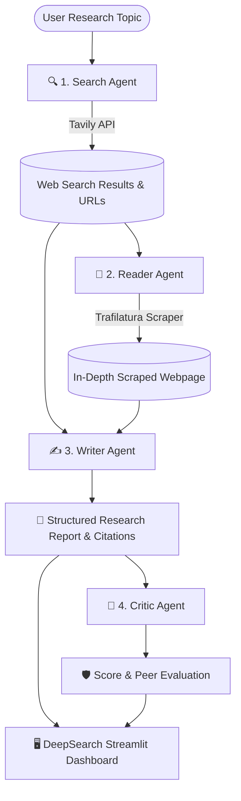

# 🔍 DeepSearch — Autonomous Multi-Agent AI Research System

[](https://www.python.org/)
[](https://python.langchain.com/)
[](https://ai.google.dev/)
[](https://streamlit.io/)
[](LICENSE)

**DeepSearch** is an autonomous, orchestrated multi-agent research studio. Powered by **LangChain**, **LangGraph**, and **Google Gemini**, DeepSearch coordinates four specialized AI agents to discover web sources, extract in-depth webpage content, synthesize structured executive reports, and perform rigorous peer review.

---

## 🌟 Key Features

- **Autonomous 4-Agent Orchestration**:
  - 🔍 **Search Agent**: Queries Tavily for real-time web results, snippets, and verified source URLs.
  - 📖 **Reader Agent**: Evaluates discovered sources, picks the most authoritative page, and extracts clean article text using Trafilatura & Readability.
  - ✍️ **Writer Agent**: Compiles the gathered intelligence into a structured executive report with mandatory clickable citations.
  - 🧐 **Critic Agent**: Evaluates the report for factual grounding, technical depth, and citation quality, assigning a numerical score out of 10.
- **Interactive Streamlit Web Studio (`app.py`)**:
  - Live step-by-step progress tracking with real-time status indicators.
  - Dedicated **Source URLs & Provenance** tab tracking every Tavily URL and the primary scraped target.
  - Executive report presentation with one-click **Markdown (.md) download**.
  - Review dashboard with scores, strengths, and recommendations.
- **Robust & Resilient Design**:
  - Built-in fallback search to guarantee real URLs on every run.
  - Windows console UTF-8 safe encoding to prevent charmap errors.
  - Privacy-preserving architecture: API credentials stay protected in `.env` and are never exposed in the UI.

---

## 🏗️ System Architecture



---

## 📁 Project Structure

```text
lang-chain-multi-agents/
│
├── app.py                     # Streamlit Web Application
├── main.py                    # Terminal / CLI Execution Entry Point
├── pyproject.toml             # Project metadata & dependency definitions
├── uv.lock                    # Locked dependency versions
├── .env.example               # Template for environment variables
├── README.md                  # Project documentation
│
└── src/
    ├── agents/
    │   ├── __init__.py
    │   └── agents.py          # Agent factories (Search, Reader) & Chains (Writer, Critic)
    ├── pipelines/
    │   ├── __init__.py
    │   └── pipelines.py       # Multi-agent orchestration pipeline & URL extraction
    └── tools/
        ├── __init__.py
        └── tools.py           # LangChain tool implementations (web_search, scrape_url)
```

---

## 🚀 Getting Started

### 1. Prerequisites

- **Python** `>= 3.12`
- **[uv](https://docs.astral.sh/uv/)** (recommended fast package runner) or standard `pip`
- **Google Gemini API Key** ([Google AI Studio](https://aistudio.google.com/))
- **Tavily API Key** ([Tavily AI](https://tavily.com/))

### 2. Installation

Clone this repository and navigate to the project directory:

```bash
git clone https://github.com/MunimChoudhary/lang-chain-multi-agents.git
cd lang-chain-multi-agents
```

Install dependencies using `uv`:

```bash
uv sync
```

*(Or using standard pip: `pip install -r pyproject.toml`)*

### 3. Environment Configuration

Copy the example environment file and configure your API keys:

```bash
# On Windows (PowerShell)
Copy-Item .env.example .env

# On macOS/Linux
cp .env.example .env
```

Open `.env` and fill in your keys:

```env
GOOGLE_API_KEY=your_google_gemini_api_key_here
TAVILY_API_KEY=your_tavily_api_key_here
```

---

## 💻 Usage

### Option A: Launch the Streamlit Web App (Recommended)

Start the modern DeepSearch interface:

```bash
uv run streamlit run app.py
```

Open your browser at **`http://localhost:8501`** to:
1. Enter any research query or choose a template topic.
2. Watch live agent step-by-step progress.
3. Inspect discovered source URLs, deep-scraped content, and the peer critique.
4. Download the generated research report as Markdown.

### Option B: Run via CLI

You can also execute the pipeline directly in your terminal:

```bash
uv run main.py
```

---

## ⚙️ Configuration & Model Details

The system is configured in [`src/agents/agents.py`](src/agents/agents.py) to use **`gemini-3.5-flash-lite`** by default:
- **Speed & Latency**: Sub-second to 2-second responses for tool calling.
- **Free Tier Friendly**: Separate, generous quota pool on Google AI Studio's free tier.
- You can switch models (e.g. to `gemini-3.5-flash` or `gemini-1.5-pro`) by modifying `llm = ChatGoogleGenerativeAI(model=...)` in [`src/agents/agents.py`](src/agents/agents.py).

---

## 🛡️ License

This project is licensed under the [MIT License](LICENSE).

